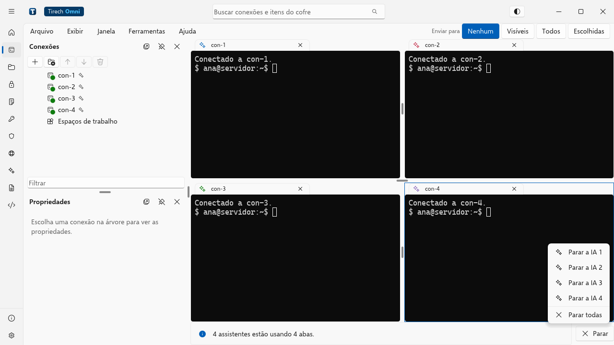
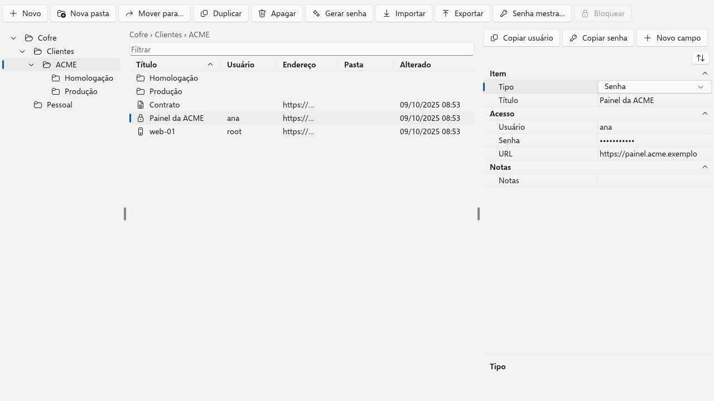
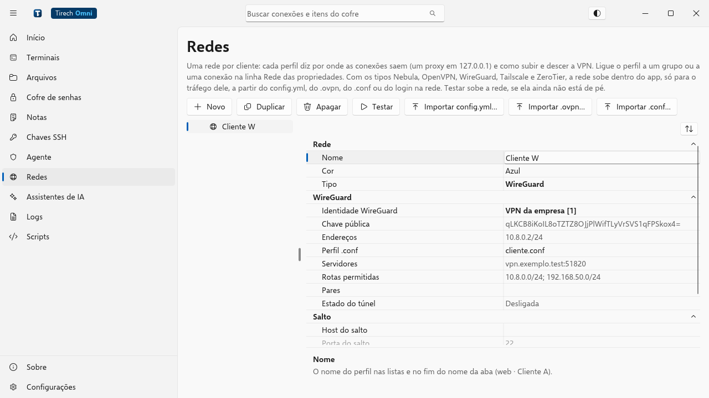

# Tirech Omni

[Português](../pt-BR/README.md) · **English**

A connection manager for SSH, local shell, Telnet and serial, with tabbed and grid terminals, a
password vault, SSH keys and agent, remote files and built-in VPNs that run without admin
rights. It works on Linux, Windows and macOS, with the Windows 11 look, and can be operated by
AI assistants such as Claude Code, Codex and OpenCode.

<p align="center">
  
</p>

## Features

- **Connections** in a tree with folders, property inheritance, search (Ctrl+E), pinned and
  recent items. SSH with jump host, proxy, agent, X11, `-L`, `-R` and `-D` tunnels and
  keepalive; Telnet, serial and the local shell.
- **Terminals** in tabs and grids (1, 2 × 2, 3 × 3), across multiple windows, with typing sent
  to several terminals at once, persistent sessions in tmux or screen, logging and commands on
  connect.
- **Encrypted password vault**, with a generator, an optional master password, Markdown notes
  with attachments and copying to another machine in a single file. Imports and exports the
  Bitwarden format and reads KeePassXC CSV.
- **SSH keys and agent**: generate, import and convert keys, the app's own agent for the
  system's `ssh` and, on Windows, Pageant for PuTTY, WinSCP and FileZilla.
- **Files** in two panes: SFTP, FTP and FTPS, S3 and compatibles, and other clouds through
  `rclone`, with a transfer queue and editing of remote files.
- **Client networks**: built-in OpenVPN, WireGuard, Tailscale, Nebula and ZeroTier, per folder
  or per connection. Only the app's traffic goes through the VPN, with no virtual network
  adapter and no admin rights, and two clients with the same IP can coexist.
- **AI assistants**: an assistant on your computer operates the app over MCP (opens
  connections, reads the screen, types, runs commands), with per-connection permissions,
  approval and auditing. "Control with" opens Claude Code, Codex or OpenCode in a tab tied to a
  session. The app also installs and opens these assistants on the server, and has its own AI
  that suggests commands.
- **Import** from `~/.ssh/config`, WinSSHTerm, PuTTY and KiTTY, WinSCP, FileZilla, mRemoteNG and
  MobaXterm, with a preview.
- **Server ports**: what is listening on the server, with one click to forward the port or open
  the page in the browser through the SSH channel.
- Interface in **Portuguese, English and Spanish**.
- **Portable** version for Windows, **ARM** packages, system tray and per-user installation
  without admin rights.

<p align="center">
  
  
</p>
<p align="center">
  
</p>

The [manual](manual.md) describes each feature, the keys, the settings and
where the app stores each file.

## Download

The packages are on the [Releases](https://github.com/TirechCorp/tirech-omni/releases) page:

| Package | For |
| --- | --- |
| `tirech-omni-portable-windows.zip` | Windows 10 and 11 x64, portable: unzip it and run `tirech-omni.exe` |
| `tirech-omni-portable-windows-arm64.zip` | Windows 11 ARM, portable |
| `tirech-omni-linux-x64.tar.gz` | Linux x64 (glibc 2.35 or newer: Ubuntu 22.04, Debian 12 and similar) |
| `tirech-omni-linux-arm64.tar.gz` | 64-bit Linux ARM (Raspberry Pi 4 and 5 with a 64-bit OS, and similar) |
| `tirech-omni-linux-armv7.tar.gz` | 32-bit Linux ARM (armhf) |

Each package includes the app, the command-line tools (`tirech-omni-keygen`,
`tirech-omni-agent`, `tirech-omni-add` and `tirech-omni-copy-id`) and
`THIRD-PARTY-NOTICES.txt`. The release's `SHA256SUMS.txt` verifies the downloads
(`sha256sum -c SHA256SUMS.txt --ignore-missing`). For macOS, for now, build from source.

## Building

The app depends on [Tomni UI](https://github.com/TirechCorp/tomni-ui) by path
(`../tomni-ui`): clone both side by side.

```sh
git clone https://github.com/TirechCorp/tomni-ui
git clone https://github.com/TirechCorp/tirech-omni
cd tirech-omni
cargo run --release -p tirech-omni
```

The Rust version is pinned in `rust-toolchain.toml` (requires `rustup`); the minimum supported
version is 1.89.

The workspace has two packages:

| Package | What |
| --- | --- |
| `tirech-omni` | the app |
| `tirech-omni-tools` | `tirech-omni-keygen`, `tirech-omni-agent`, `tirech-omni-add` and `tirech-omni-copy-id`: `ssh-keygen`, `ssh-agent`, `ssh-add` and `ssh-copy-id` on the command line, with the app's keys |

### Packages

| Script | Produces |
| --- | --- |
| `empacotar-portable.sh` | the Windows portable zip, from `cargo build --release --target x86_64-pc-windows-gnu -p tirech-omni -p tirech-omni-tools` |
| `empacotar-arm.sh` | the 64- and 32-bit Linux ARM packages and the Windows ARM portable, built through Docker on an x86_64 computer |

## Where the app stores its data

In the system configuration folder (`~/.config/tirech-omni` on Linux), in the folder pointed to
by the `TIRECH_OMNI_CONFIG` variable or, in the portable version, in the `tirech-omnidata`
folder next to the executable. The list of files is in the
[manual](manual.md#where-the-files-are).

## Security

The app saves passwords, as connection managers usually do, and keeps them encrypted:

- The vault (`vault.json`) is encrypted with AES-256-GCM. Without a master password, the key is
  stored in `vault.key`, next to it, and the vault opens on its own; with a master password, the
  key is derived from it with Argon2id and is not stored. On Linux and macOS, the vault is
  written with 0600 permissions.
- Text sent to an AI first goes through secret redaction.
- MCP talks over a Unix socket owned by the user (or an owned pipe, on Windows), and the VPNs'
  SOCKS5 bridge listens only on `127.0.0.1`, with a random port and random credentials.

Protecting the machine and deciding on a master password is up to the user: the app doesn't
add barriers such as automatic locking or extra confirmations. To report a vulnerability, see
[`SECURITY.md`](SECURITY.md).

## Contributing

Read [`CONTRIBUTING.md`](CONTRIBUTING.md) (the CI checks, the layout and the rules) and the
[code of conduct](CODE_OF_CONDUCT.md). New widgets and protocols usually belong in
[Tomni UI](https://github.com/TirechCorp/tomni-ui), not in the app.

## License

MIT or Apache-2.0, at your option ([`LICENSE-MIT`](../../LICENSE-MIT),
[`LICENSE-APACHE`](../../LICENSE-APACHE)). Dependencies are restricted to permissive licenses
(`cargo deny check licenses`).
